<a href="docs/assets/hero-light.svg">
<picture>
  <source media="(prefers-color-scheme: dark)" srcset="docs/assets/hero-dark.svg">
  
</picture>
</a>

**sage-bot lets a small team build software together from a Discord server.** It is a bridge between Discord and a Claude Code session that runs [sage](https://github.com/erickb336/sage). The graphic shows the goal. A sage-lead requests a new feature in a thread. sage designs it and posts its design questions back as cards. The team asks, comments and votes, and a sage-lead breaks ties. sage builds, with reviews and tests, and posts its progress and results in the thread: the board, screenshots and the link to the pull request. The owner merges. Nobody on the team needs a terminal.

**Today:** design questions as vote cards, team votes, a sage-lead's tie-break or early end, read asks (the board, a task, the open questions and the shared files) and the kill switch work. A sage-lead's request does not reach a live Claude Code session yet: no Discord text reaches sage as an instruction. Bridge sessions add steps 1, 2 and 6 of the graphic; they wait on T159.

Ids such as T159 are sage task ids in this project's logbook. A G-id, such as G42, is a gate: a question that sage parks for the owner. The [reference](docs/reference.md) gives the gates and findings behind each rule.

<p align="center">
  <a href="https://github.com/erickb336/sage-bot/actions/workflows/check.yml"></a>
</p>

**Contents:** [Quick start](#quick-start) · [How it works](#how-it-works) · [Roles](#roles) · [What to say](#what-to-say) · [Safety](#safety) · [Set up a live trial](#set-up-a-live-trial) · [Concepts](#concepts) · [FAQ](#faq) · [Under the hood](#under-the-hood) · [Credits](#credits)

> **Status: built and tested on a fake Discord; the live trial has not run yet.** Read asks, team votes, the sage-lead log and the kill switch run in the tests and in the demo. Bridge sessions (a sage-lead who instructs sage, writes and starts build sessions) are not built: they wait on T159.

## Quick start

You need Node 24 or later and the [sage](https://github.com/erickb336/sage) plugin in Claude Code. You do not need a Discord account, an app or a token for the demo.

**1. Get the code:**

<!-- check: skip, the test runs in a copy of this folder -->
```sh
git clone https://github.com/erickb336/sage-bot.git
cd sage-bot
```

**2. Install** (in the sage-bot folder):

<!-- check: run -->
```sh
npm ci
```

**3. Play the demo:**

<!-- check: run, prints "Page: " -->
```sh
npm run demo
```

The demo plays one sage session from start to end, with sample people and a scripted clock, on a fake Discord. It uses the real sage state tool, the real hook and the real bridge. It prints each step and the path of one HTML page.

**4. Open the page.** Open the path that the demo prints after `Page:`. The page shows the session's thread, each card at its final state, the private notes that each person sees, and the answers that sage got. The [reference](docs/reference.md#the-demo) gives the demo's options.

<a href="docs/assets/tip-mention-light.svg">
<picture>
  <source media="(prefers-color-scheme: dark)" srcset="docs/assets/tip-mention-dark.svg">
  
</picture>
</a>

To connect a real Discord server, follow [Set up a live trial](#set-up-a-live-trial).

## How it works

sage-bot is one small service, the bridge, on the owner's Mac. The graphic at the top shows the loop that it is for. Today it does three jobs:

1. **It answers read asks.** A member mentions @sage-bot, or types `/sage`. The bridge checks the member's role and the hourly limit, reads sage's logbook, and answers. Code writes the answer, with no AI.
2. **It runs team votes.** sage marks a product question for the team. The bridge posts it as a card with a button for each option. When the question is decided, the bridge gives sage only the chosen option.
3. **It records a sage-lead's talk.** A sage-lead's mention with the word "talk" opens a sage-lead thread. The bridge writes each message to the sage-lead log and to #sage-audit. It does not go to sage yet: bridge sessions wait on T159. They will carry a sage-lead's words to sage.

The bridge only reads the logbook, and it changes it only through the sage state tool. The owner's answer at the terminal is always final.

### A mention opens a thread

- Each mention in a registered channel opens a public thread, named from the request. The answer goes into the thread.
- A mention inside that thread continues it. sage-bot cannot read a message that does not mention it.
- A mention in a thread that sage-bot did not open, or in a forum post, gets one reply: mention me in the channel.
- The threads survive a restart of the bridge.

## Roles

The Discord admin gives each person on the team one of two roles. A member with both counts as a sage-lead.

| | sage-apprentice | sage-lead |
| --- | --- | --- |
| Read the board, a task, the open questions and the shared files | Yes | Yes |
| Answer a single question, and vote on a batch | Yes | Yes |
| Break a tie, or end a vote early | No | Yes |
| Recommend on the autopilot question (the owner decides) | No | Yes |
| Unregister a channel | No | Yes |
| Turn off the link from Discord to sage (`/sage stop`) | No | Yes |
| Talk to sage, write, and start build sessions | No | Not built: waits on T159 |
| Asks in a rolling hour | 10 | 10 |

A member with neither role gets no reply, and nothing they do counts. Only the owner registers a channel, and only the owner turns the link to sage on again, both at the terminal.

## What to say

Each answer is public and pings nobody. The answer to a mention goes into its thread. Leave out `project` for the project of the channel. The examples use sample ids.

**As a sage-apprentice or a sage-lead:**

| You want to | Say this |
| --- | --- |
| See the tasks by state, the tasks left and the open questions | `@sage-bot board` or `/sage board [project]` |
| See one task: its title, size, state and pull request | `@sage-bot T7` or `/sage task T7 [project]` |
| See the open questions, sage's recommendation and the default | `@sage-bot gates` (or `questions`), or `/sage gates [project]` |
| Get the project's shared graphics and PDFs | `@sage-bot files` or `/sage files [project]` |
| Answer or vote on a team question | Press an option on its card |

A mention that names none of these words gets a reply that lists them.

**As a sage-lead, also:**

| You want to | Say this |
| --- | --- |
| Break a tie | Press a tie-break button on the card |
| Recommend on the autopilot question | Press Yes or No on its card. The owner decides at the terminal. |
| Stop sage-bot in this channel | `/sage unregister`, then the confirm button within 10 minutes |
| Turn off the link from Discord to sage | `/sage stop`, then the confirm button within 10 minutes |
| Talk to sage | `@sage-bot talk …`: recorded in the sage-lead log only, until bridge sessions come with T159 |

**As the owner, at the terminal** (in the sage-bot folder). These commands read the bridge's config, `~/.config/sage-bot/config.json`: make it first with the [setup guide](docs/setup.md#the-checklist), step 3.

| You want to | Run this |
| --- | --- |
| Send a question to the team | `node scripts/vote.mjs --project <project> G42` |
| Register a channel for a project (stop the bridge first) | `node scripts/channels.mjs register <channel id> <project>` |
| See if the link from Discord to sage is on | `node scripts/leads.mjs status` |
| Turn the link on again | `node scripts/leads.mjs restore` |
| Check the sage-lead log | `node scripts/leads.mjs verify` |

Time left is not estimated yet: the board shows the count of tasks left. The [setup guide](docs/setup.md#channels) tells how to register a channel, and the [reference](docs/reference.md#the-bridge-service) gives every command and option.

## Safety

**On now, for every ask:**

- **Roles and registered channels.** sage-bot works only in the channels that the owner registers, and only for the two roles.
- **An hourly limit.** Each person can ask 10 times in a rolling hour, across all channels.
- **No AI reads Discord text.** Code answers each read ask. A vote gives sage only the option's letter and sage's own option text. sage reads a reason only through `scripts/reasons.mjs`, cleaned by an allow-list.
- **The answer shows little.** It shows a task's id, title, size, state and pull request, and the open questions. It never reads findings, briefs, reports or `decisions.tsv`.
- **The sage-lead log.** Each message of a sage-lead to sage-bot goes into an append-only log first, with a hash chain, and a copy goes to #sage-audit.
- **The kill switch.** A sage-lead or the owner types `/sage stop` and confirms. Nothing of a sage-lead then goes to sage until the owner turns the link on again at the terminal. Read asks keep working.

**For bridge sessions, not on yet (T159):**

A bridge session will be a headless `claude -p` session that sage-bot starts for one sage-lead thread, so that a sage-lead can instruct sage. Four layers will limit it:

- **The sandbox settings** (built and tested) hold the file and network boundary. They allow no GitHub host, and they deny the sage plugin folder, every logbook and the secret files.
- **The guard hook** (built and tested) is a second layer. It allows only the commands on its allow-list.
- **The broker** (built, not used by a session until T159) will give the session a few GitHub verbs: a fetch, an upload to its own branch, and its own pull request. None of them merges.
- **A spend cap** (built): the bridge policy starts each session with `--max-budget-usd 5`.

A text hook is only a second layer: the sandbox holds each file and network boundary. `npm run proof` checks the sandbox settings (it needs the `claude` command on PATH), and `npm run proof:live` runs the probes in real sessions. The [reference](docs/reference.md#the-guard-for-bridge-sessions) gives each layer and the findings behind it, and [the proof](docs/reference.md#the-proof-of-the-sandbox) lists each row.

## Set up a live trial

> **The live trial has not run yet.** The owner does each step by hand. sage-bot changes no settings file, and it never types a token.

The [setup guide](docs/setup.md) has the full checklist: each command, the permissions table and the reason for each step. In short:

1. **Make a Discord app only for sage-bot.** Turn on the Server Members intent, and leave the Message Content intent off.
2. **Make two mentionable roles:** `sage-apprentice` and `sage-lead`.
3. **Fill in the config** in `~/.config/sage-bot/config.json`, from `examples/config.example.json`.
4. **Set the channel permissions,** so that only the two roles can ask, and sage-bot can open and lock threads.
5. **Put the token in the Keychain** as the item `sage-bot`. Never type the token in a shell.
6. **Add the hook lines** to `.claude/settings.local.json` in each project.
7. **Deny the Discord plugin's `fetch_messages` tool** in the same settings file.
8. **Start the bridge** by hand once, then with launchd.
9. **Do a smoke test:** mark one test question, and press an option on its card.

## Concepts

| Word | Meaning |
| --- | --- |
| **sage** | The Claude Code plugin whose session frames the work and asks the questions. |
| **The owner** | The person who runs sage at the terminal. The owner's answer is always final. |
| **The bridge** | sage-bot's service on the owner's Mac: `scripts/bridge.mjs`. |
| **sage-apprentice** | The Discord role that reads and asks, and answers and votes. |
| **sage-lead** | The Discord role that can do everything an apprentice can, and also breaks ties and stops the link. |
| **Registered channel** | A channel where sage-bot works, for one project. Only the owner registers one. |
| **Answer thread** | A thread that a mention opens. sage-bot answers read asks there. |
| **Sage-lead thread** | A thread that a sage-lead's "talk" opens. Each message there goes into the sage-lead log. |
| **Question** | A sage gate: a question that sage parks for the owner, with options, a recommendation and a default. |
| **Team vote** | A question that sage marks for the team with `scripts/vote.mjs`. |
| **Card** | The Discord message of one question or one batch, with a button for each option. |
| **Sage-lead log** | The append-only record of every message that a sage-lead sends to sage-bot, with a hash chain. |
| **Kill switch** | `/sage stop`: it turns off the link from Discord to sage until the owner turns it on at the terminal. |
| **Bridge session** | Not built (T159). A sage session that sage-bot will start for one sage-lead thread, so that a sage-lead can instruct sage, inside the sandbox, the guard hook and the $5 cap. |

## FAQ

**Does a Discord message ever reach sage?** Not as an instruction, today. A read ask only reads the logbook. A vote gives sage only the chosen option. A sage-lead's talk goes only into the sage-lead log until bridge sessions come with T159.

**Can a teammate start work?** Not yet. A session starts only at the owner's terminal. Bridge sessions, which will let a sage-lead start build sessions, wait on T159.

**Who decides the autopilot question?** The owner. The sage-leads only recommend Yes or No. sage-bot never switches a mode of sage.

**What if the Mac sleeps?** The bridge stops while the Mac sleeps, so Discord shows "This interaction failed" for a press. When the Mac wakes, the bridge ends each vote that passed its limit and asks the team to press again.

**What does a person with no role see?** Nothing from sage-bot. Discord itself shows "The application did not respond" for a `/sage` command, or "This interaction failed" for a button, to that person only.

**Why does every mention open a thread?** Each request and its answer stay together, and the channel stays readable.

## Under the hood

| Path | What it is |
| --- | --- |
| `src/ask.js` | Read asks, `/sage` and the limit |
| `src/threads.js` | Mention threads |
| `src/vote.js` | The vote rules |
| `src/cards.js` | The cards |
| `src/handle.js` | A press of a button |
| `src/bridge.js` | The bridge's loop |
| `src/discord.js` | The only link to Discord |
| `src/audit.js` | Sage-lead log, kill switch |
| `src/guard.js` | Guard hook (not on yet) |
| `src/session-policy.js` | Sandbox (not on yet) |
| `scripts/` | Commands, demo, graphics |
| `docs/setup.md` | The live trial checklist |
| `docs/reference.md` | **Every rule and setting** |

To run the checks:

<!-- check: skip, the check runs this test itself -->
```sh
npm run check
```

The check runs every test with sample data and a fake Discord. No test connects to Discord or reads the Keychain. The [check workflow](.github/workflows/check.yml) runs it on each push to main and on each pull request.

## Credits

- sage-bot is built for, and follows the rules of, [sage](https://github.com/erickb336/sage). Its graphics reuse sage's look and its toad sage: `scripts/sage-world.mjs` is a copy of sage's graphics code at commit `b0af484`, under the MIT licence.
- It uses [discord.js](https://discord.js.org) for the shapes of Discord messages, and [playwright-core](https://playwright.dev) for the screenshots.
- The Discord symbol in the diagrams is Discord's own file, unchanged, used to name the service in a flow. Discord is a trademark of Discord Inc. sage-bot is not affiliated with Discord.

## Licence

Private, not licensed for use by others (`UNLICENSED` in `package.json`).
