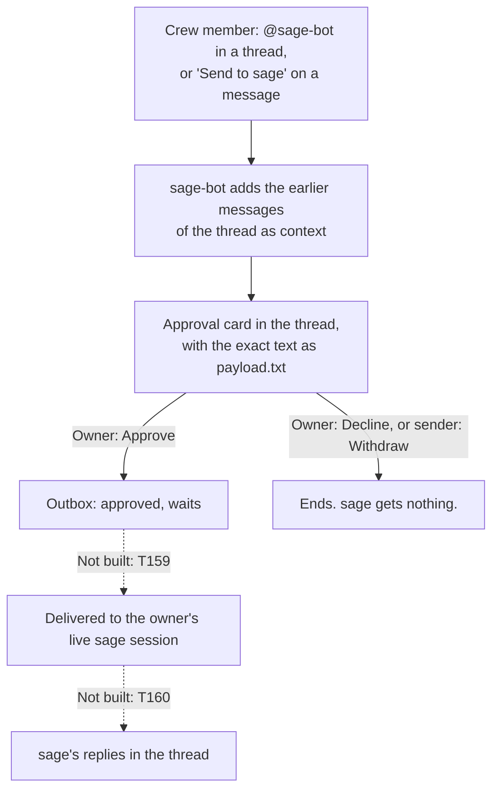

# sage-bot

**sage-bot is a Discord bot that lets a small team steer one person's [sage](https://github.com/erickb336/sage) session in Claude Code, with that person's approval for every action.**
A team of 2 to 5 people requests features, votes on design questions and sends instructions from Discord. Nobody on the team needs a terminal, and no instruction from Discord reaches sage until the owner approves it.

<picture><source media="(prefers-color-scheme: dark)" srcset="docs/assets/hero-dark.svg"></picture>

[](https://github.com/erickb336/sage-bot/actions/workflows/check.yml) · [MIT licence](LICENSE) · **Contents:** [Quick start](#quick-start) · [Usage](#usage) · [How it works](#how-it-works) · [Set up a live trial](#set-up-a-live-trial) · [FAQ](#faq)



*A message from Discord to sage. The solid steps work today. The dotted steps are not built: they wait for work in sage (T159, T160). The owner's own message skips the card and is approved at once.*

> **Status: built and tested on a fake Discord. The live trial has not run yet.** Requests, task threads, team votes, lookups, the outbox, the catch-up and the emergency stop run in the tests and in the demo. An approved message waits in the outbox: delivery into a live sage session (T159) and replies in the thread (T160) are not built.

Ids such as T159 are sage task ids in this project's logbook. A G-id, such as G42, is a gate: a question that sage parks for the owner. The [reference](docs/reference.md) gives the gates and findings behind each rule.

## Quick start

You need Node 24 or later. The demo needs no Discord account, app or token.

**1. Get the code:**

<!-- check: skip, the test runs in a copy of this folder -->
```sh
git clone https://github.com/erickb336/sage-bot.git
```

**2. Go into its folder.** Run the next commands there.

<!-- check: skip, the test runs in this folder already -->
```sh
cd sage-bot
```

**3. Install:**

<!-- check: run -->
```sh
npm ci
```

**4. Play the demo:**

<!-- check: run, prints "Page: " -->
```sh
npm run demo
```

The demo plays one sage session from start to end on a fake Discord, with sample people and a scripted clock. It uses the real sage state tool, the real hook and the real bridge. It prints each step, then `Page:` and the path of one HTML page.

**5. Open the page** at that path. It shows the thread, each card at its final state, the private notes that each person sees, and the answers that sage got. The [reference](docs/reference.md#the-demo) gives the demo's options.

To connect a real Discord server, follow [Set up a live trial](#set-up-a-live-trial).

## Usage

Each answer is public and pings nobody. Leave out `project` to use the project of the channel. The examples use sample ids.

**As a crew member, in Discord:**

| You want to | Do this | What you see |
| --- | --- | --- |
| See the board | `@sage-bot board`, or `/sage board [project]` | The tasks by state, the tasks left, the open questions and the waiting requests |
| See one task | `@sage-bot T5`, or `/sage task T5 [project]` | Its title, size, state and pull request |
| See the open questions | `@sage-bot gates`, or `/sage gates [project]` | Each question, sage's recommendation and the default |
| Get the shared graphics and PDFs | `@sage-bot files`, or `/sage files [project]` | The files that the owner shares |
| Request a feature | `/sage request [project]`, fill in the form, check it, then press Send | One line in the channel, and a thread with the request card. The owner approves or declines it there. You can withdraw it while it waits. |
| Vote on a design question | Press an option on its card | Your vote counts. At the limit, the votes decide. |
| Send an instruction to sage | `@sage-bot implement what we discussed above` in a thread, or "Send to sage" in the Apps menu of a message | An approval card in the thread. It waits for the owner. |
| Stop the link from Discord to sage, in an emergency | `/sage stop`, then the confirm button within 10 minutes | The link goes off at once, with no approval |

**As the owner, in Discord:** press Approve or Decline on a request card or a message card, break a tie or end a vote early on its card, and `/sage unregister` a channel. Your own mention or "Send to sage" is approved at once.

**As the owner, at the terminal** (in the sage-bot folder). These commands read the bridge's config, `~/.config/sage-bot/config.json`. Make it first with step 3 of the [setup guide](docs/setup.md#the-checklist).

| You want to | Run this |
| --- | --- |
| Approve a request | `node scripts/requests.mjs approve RQ1` |
| See the messages to sage, or one message and its payload | `node scripts/outbox.mjs list`, `node scripts/outbox.mjs show M1` |
| Decline or withdraw a waiting message (Approve is only on its card) | `node scripts/outbox.mjs decline M1 --reason "not this week"`, `node scripts/outbox.mjs withdraw M1` |
| Send a question to the team | `node scripts/vote.mjs --project <project> G42` |
| Register a channel for a project (stop the bridge first) | `node scripts/channels.mjs register <channel id> <project>` |
| See if the link from Discord to sage is on | `node scripts/leads.mjs status` |
| Turn the link on again after a stop | `node scripts/leads.mjs restore` |
| Check the audit log | `node scripts/leads.mjs verify` |

The [reference](docs/reference.md#the-bridge-service) gives every command and option.

## Why

sage runs in one person's terminal. A team that wants to take part has two other ways today, and both are weak:

| Way | Problem |
| --- | --- |
| Share the terminal, or relay each message by hand | Only one person can type, and the owner becomes the relay for every question. |
| Connect a Discord chat directly to the sage session | Any message in the channel reaches the session as an instruction, with no review. |

sage-bot sits between the two. The team works in Discord, and the owner approves each action before it can reach sage.

## How it works

sage-bot is one small service, the bridge (`scripts/bridge.mjs`), on the owner's Mac. It reads sage's logbook and changes it only through the sage state tool. Code writes every answer: no AI reads Discord text today.

| Job | What happens |
| --- | --- |
| Lookups | A mention or `/sage` asks for the board, a task, the open questions or the files. The bridge checks the person and the hourly limit, reads the logbook and answers. A mention opens a thread for the answer. |
| Requests | `/sage request` makes a request card in its own thread. Only the owner approves or declines it. After Approve, the request becomes a sage task, and its thread becomes the **task thread**. |
| Team votes | When sage marks a design question of that task as a team vote, its card goes to the task thread. Every crew member votes within 10 minutes. Then the votes decide. Only the owner breaks a tie or ends a vote early. Other questions stay in the home channel, with 30 minutes. |
| The outbox | A crew mention that is not a lookup, or "Send to sage", becomes a message to sage. The bridge reads the earlier messages of the thread as context: at most 30 messages and 8,000 characters, back to the last message to sage. The owner approves the exact payload on its card. The diagram at the top shows the flow. |
| The catch-up | Discord does not send the messages of a time when the bridge was offline, for example while the Mac slept. At each reconnect, the bridge reads them back and answers each missed mention once. A mention older than 24 hours gets "This is old, please ask again." |
| The emergency stop | Any crew member's `/sage stop` turns off the link from Discord to sage at once. Then nobody can approve a request or a message to sage, and new messages wait. Lookups keep working. Only the owner turns the link on again, at the terminal. |

### Who is who

One sage-bot serves one owner, on that owner's Mac, with that owner's own Discord app. Each bot serves one or more projects. Several owners can each run a bot in the same server: each bot keeps its own cards, threads, requests and files.

- **The owner** is one Discord user id, set at setup: `ownerId` in the config, else the owner of the Discord app. A role never makes anyone the owner. The owner approves every action on their own bot.
- **The crew** is every member with the role named exactly `sage-crew`. Every bot in a server shares that one role, so a crew member can request on each bot.
- **Anyone else** gets one private line, "Only the sage-crew role can use sage-bot.", for a `/sage` command or a button press. Their mentions get no reply. Nothing that they do counts.
- **A direct message** does nothing. sage-bot does not ask Discord for direct-message events.

| | The crew | The owner |
| --- | --- | --- |
| Lookups, requests, votes, messages to sage | Yes | Yes (votes only with the `sage-crew` role) |
| Withdraw your own request or message while it waits | Yes | Yes (your own message is approved at once) |
| Approve or decline a request or a message to sage | No | Yes |
| Break a tie, or end a vote early | No | Yes |
| `/sage stop` | Yes | Yes |
| Turn the link on again, register or unregister a channel | No | Yes |
| Asks in a rolling hour | 10 | 10 |

The [setup guide](docs/setup.md#who-is-who) tells how sage-bot finds the owner, and how [a second owner joins the server](docs/setup.md#a-second-owner-joins-the-server).

### Safety

- **Registered channels only.** sage-bot works only in the channels that the owner registers, and their threads.
- **The owner's approval.** A message reaches the outbox as approved only after the owner presses Approve on its card, which shows the exact payload as payload.txt. In the payload, the context messages are quoted data in a marked block, not instructions.
- **The audit log.** Each message to sage and each decision on it goes into an append-only log with a hash chain. When the config names an audit channel, a copy goes to #sage-audit.
- **Bridge sessions, not on yet (T159).** A bridge session will be a headless `claude -p` session that delivers the approved messages. The sandbox settings (built and tested) will hold its file and network boundary. The guard hook (built and tested) is a second layer. A spend cap of $5 limits each session. `npm run proof` checks the sandbox settings. The [reference](docs/reference.md#the-guard-for-bridge-sessions) gives each layer.

## What's new

Newest first. The [issue 60](https://github.com/erickb336/sage-bot/issues/60) comments give the design decisions and the plan.

1. **The outbox** (T247, PR 67). A crew mention or "Send to sage" becomes a message to sage, with the context of the thread. The owner approves it on a card with payload.txt.
2. **Task threads** (T245, PR 66). After Approve, a request's thread becomes the task thread, with 10-minute team votes.
3. **Many bots in one server** (T244, PR 65). Each owner runs their own bot, and the bots stay apart.
4. **The catch-up** (T241, PR 64). After the Mac sleeps, the bridge answers the mentions that it missed.
5. **Team requests** (T228, PR 63). Every crew member can use `/sage request`; only the owner approves.

**Next:** delivery into a live sage session (T159) and replies in the thread (T160). Both wait for work in sage.

## Set up a live trial

> **The live trial has not run yet.** The owner does each step by hand. sage-bot changes no settings file, and it never types a token.

The [setup guide](docs/setup.md) has the full checklist, with each command and the reason for each step. In short:

1. **Make a Discord app only for sage-bot, with your own account.** Guild Install only, Public Bot off. Turn on the **Server Members** and **Message Content** intents: sage-bot reads the thread as the context of a message to sage.
2. **Invite it** with the `bot` and `applications.commands` scopes and the permission integer `326417632256`.
3. **Make one mentionable role named `sage-crew`,** or use the one that the server has already.
4. **Fill in the config** in `~/.config/sage-bot/config.json`, from `examples/config.example.json`.
5. **Set the channel permissions,** so that only the crew can ask, and sage-bot can open and lock threads.
6. **Put the token in the Keychain** as the item `sage-bot`. Never type the token in a shell.
7. **Add the hook lines,** and deny the Discord plugin's `fetch_messages` tool, in `.claude/settings.local.json` of each project.
8. **Start the bridge** by hand once, then with launchd.
9. **Do a smoke test:** mark one test question, and press an option on its card.

## Concepts

| Word | Meaning |
| --- | --- |
| **sage** | The Claude Code plugin whose session frames the work and asks the questions. |
| **Owner** | The one person who runs this sage-bot and its sage, known by Discord user id. The owner approves every action. |
| **Crew** | Every member with the Discord role named `sage-crew`. |
| **Bridge** | sage-bot's service on the owner's Mac. |
| **Registered channel** | A channel where sage-bot works, for one project. |
| **Request** | A feature that a crew member asks for with `/sage request`. It becomes a sage task after the owner approves it. |
| **Task thread** | The thread of an approved request. The team votes of its task go there. |
| **Question** | A sage gate: a question that sage parks for the owner, with options, a recommendation and a default. |
| **Team vote** | A question that sage marks for the crew. Its card has a button for each option. |
| **Message to sage** | An instruction from Discord, with its context, kept in the outbox. |
| **Outbox** | The bridge's record of every message to sage and its status: waiting, approved, declined or withdrawn. |
| **Payload** | The exact text that sage will get for one message, shown as payload.txt on its card. |
| **Emergency stop** | `/sage stop`: it turns off the link from Discord to sage until the owner turns it on again. |
| **Bridge session** | Not built (T159). A sage session that sage-bot will start to deliver the approved messages. |

## FAQ

**Does a Discord message reach sage today?** No. A lookup only reads the logbook. A vote gives sage only the chosen option. An approved message waits in the outbox until bridge sessions come with T159.

**Can a crew member start work?** A crew member requests a feature, and the owner's Approve adds the sage task. A session still starts only at the owner's terminal until T159.

**What if the Mac sleeps?** The bridge is offline, so a button press fails; the card says to press it again later. When the Mac wakes, the bridge answers the mentions that it missed, and posts one line such as "I was offline from … to …. I picked up 1 message."

**Can two people each run a sage-bot in one server?** Yes. Each one makes their own Discord app and runs their own bridge. They share the `sage-crew` role. See [A second owner joins the server](docs/setup.md#a-second-owner-joins-the-server).

**Why does every mention open a thread?** Each request and its answers stay together, and the channel stays readable.

## Under the hood

| Path | What it is |
| --- | --- |
| `src/ask.js`, `src/threads.js` | Lookups, `/sage`, the limit and mention threads |
| `src/requests.js`, `src/requestFlow.js` | Requests |
| `src/vote.js`, `src/cards.js`, `src/handle.js` | The vote rules, the cards and a button press |
| `src/outbox.js`, `src/outboxFlow.js` | Messages to sage and their approval cards |
| `src/catchup.js` | The catch-up |
| `src/crew.js` | Who is the crew and who is the owner |
| `src/audit.js` | The audit log and the emergency stop |
| `src/bridge.js`, `src/discord.js` | The bridge's loop, and its only link to Discord |
| `src/guard.js`, `src/session-policy.js` | The guard hook and the sandbox settings (not on yet) |
| `scripts/` | The commands and the demo |
| `docs/setup.md` | The live trial checklist |
| `docs/reference.md` | Every rule and setting |

To run the checks:

<!-- check: skip, the check runs this test itself -->
```sh
npm run check
```

The check runs every test with sample data and a fake Discord. No test connects to Discord or reads the Keychain. The [check workflow](.github/workflows/check.yml) runs it on each push to main and on each pull request.

## Credits

- sage-bot is built for, and follows the rules of, [sage](https://github.com/erickb336/sage).
- It uses [discord.js](https://discord.js.org) for Discord, and [playwright-core](https://playwright.dev) for the screenshots of the demo page.
- Discord is a trademark of Discord Inc. sage-bot is not affiliated with Discord.

## Licence

sage-bot is open source under the MIT licence: see [LICENSE](LICENSE).
